<p align="center">
  <a href="https://usenock.com/mcp">
    <picture>
      <source media="(prefers-color-scheme: dark)" srcset="assets/header-en-dark.svg">
      
    </picture>
  </a>
</p>

<p align="center">
  <a href="https://cursor.com/install-mcp?name=nock&config=eyJ1cmwiOiJodHRwczovL2FwaS51c2Vub2NrLmNvbS9tY3AifQ%3D%3D"><picture><source media="(prefers-color-scheme: dark)" srcset="assets/button-cursor-en-dark.svg"></picture></a>
  &nbsp;
  <a href="https://vscode.dev/redirect?url=vscode%3Amcp%2Finstall%3F%257B%2522name%2522%253A%2522nock%2522%252C%2522type%2522%253A%2522http%2522%252C%2522url%2522%253A%2522https%253A%252F%252Fapi.usenock.com%252Fmcp%2522%257D"><picture><source media="(prefers-color-scheme: dark)" srcset="assets/button-vscode-en-dark.svg"></picture></a>
</p>

<p align="center">
  <b>English</b> &nbsp;|&nbsp; <a href="README.pt-BR.md">Português</a>
</p>

Nock (usenock.com) is a Brazilian B2B prospecting platform. Its remote MCP server
lets Claude, ChatGPT, Cursor, VS Code or any MCP client work on your Nock workspace:

- search Brazilian companies by industry, size, location, CNAE and opening date,
  and the people who decide there;
- look for buying signals: companies hiring a role, raising funding, opening new
  locations, adopting a technology or in the news;
- enrich work e-mails and mobiles and keep the results in sheets;
- draft outreach campaigns. Nothing is sent until you review and activate the
  campaign in Nock.

This repository holds only the files that directories and plugin marketplaces read.
The server itself runs at Nock.

## Install

```
https://api.usenock.com/mcp
```

One URL, Streamable HTTP. You need a Nock account (500 free credits for 7 days, no
card). Calls spend your workspace's credits, as in the dashboard.

<p align="center">
  <picture>
    <source media="(prefers-color-scheme: dark)" srcset="assets/clients-dark.svg">
    
  </picture>
</p>

###  Claude

claude.ai, desktop and mobile: **Settings → Connectors → Add custom connector**, paste
the server URL and sign in with your Nock account.

###  Claude Code

As a plugin, from this repository's marketplace:

```
/plugin marketplace add nock-ltda/nock-mcp
/plugin install nock-prospecting@nock
```

Or add the server directly:

```
claude mcp add --transport http nock https://api.usenock.com/mcp
```

Then run `/mcp` and sign in.

###  ChatGPT

**Settings**, turn on developer mode, create a connector with the server URL and sign
in with your Nock account.

###  Codex

```
codex mcp add nock --url https://api.usenock.com/mcp
codex mcp login nock
```

###  Cursor

Use the **Add to Cursor** button above, or put this in `mcp.json`:

```json
{ "mcpServers": { "nock": { "url": "https://api.usenock.com/mcp" } } }
```

###  VS Code

Use the **Install in VS Code** button above (GitHub Copilot agent mode), then sign in
with your Nock account.

###  Gemini CLI

```
gemini extensions install https://github.com/nock-ltda/nock-mcp
```

###  Windsurf

In `mcp_config.json`:

```json
{ "mcpServers": { "nock": { "serverUrl": "https://api.usenock.com/mcp" } } }
```

###  Zed

In settings:

```json
"context_servers": { "nock": { "url": "https://api.usenock.com/mcp" } }
```

## Sign in

On the first call the client opens the Nock sign-in (OAuth). Every action runs in
your own workspace and follows the permissions you granted when connecting.

Clients without OAuth can send a workspace API key, created in **Settings → API and
webhooks** in the dashboard, as `Authorization: Bearer <key>`. Never commit the key.

## Try asking

1. Find 10 marketing directors or marketing managers at retail chains in São Paulo.
2. Which fashion retailers in Brazil opened a new store in the last 30 days? Show me 5.
3. Find 10 B2B software companies in Curitiba with 11 to 50 employees and save them
   in a new sheet called "SaaS Curitiba".
4. Create a draft outreach campaign for the people in my sheet "Demo - Marketing
   leaders" and show me the first message.
5. How many Nock credits do I have left, and which of my campaigns are running?

## Tools

99 tools. Some of them, by area:

| Area | Tools |
|---|---|
| Companies and people | `search_companies`, `search_people`, `find_companies_with_rules`, `discover_decision_makers`, `company_group` |
| Buying signals | `explore_signals`, `create_signal_monitor`, `run_signal_monitor`, `list_signal_events`, `export_signal_events` |
| Enrichment | `list_enrichment_fields`, `enrich_field`, `enrich_field_batch`, `check_whatsapp`, `research_web` |
| Sheets | `create_sheet`, `add_rows_to_sheet`, `run_sheet_enrichment`, `run_sheet_ai_column`, `export_sheet_csv` |
| Campaigns | `generate_outreach_campaign`, `preview_campaign_messages`, `add_prospects_to_campaign`, `activate_outreach_campaign` |
| Inbox and leads | `list_inbox_conversations`, `get_inbox_conversation`, `brief_lead`, `find_lead` |
| Webhooks | `send_to_webhook` |
| Account | `get_credit_balance`, `get_knowledge_base`, `read_learn_article` |

`send_to_webhook` only POSTs JSON, and only to a webhook your workspace saved in
**Settings → API and webhooks** (n8n, Make, Zapier or your own system), by name. It
never takes a URL. There is no generic HTTP tool.

Tools that use data or credits are charged exactly as in the dashboard. The full list,
with what each tool does: https://usenock.com/mcp

## Works with

<p align="center">
  <picture>
    <source media="(prefers-color-scheme: dark)" srcset="assets/works-with-dark.svg">
    
  </picture>
</p>

<p align="center">
  LinkedIn, Gmail, WhatsApp, Google Sheets, HubSpot, Salesforce, Pipedrive,
  RD Station CRM, Attio, Slack, Claude, ChatGPT and n8n.
</p>

## Files

- `server.json`: the entry in the official MCP Registry (`com.usenock/nock`).
- `.claude-plugin/marketplace.json` and `plugins/nock/`: the Claude Code plugin
  (`nock-prospecting`).
- `.cursor-plugin/marketplace.json` and `plugins/nock/`: the Cursor plugin.
- `gemini-extension.json` and `GEMINI.md`: the Gemini CLI extension.
- `assets/`: the images in this README.

## Links

Docs: https://usenock.com/mcp
<br>Privacy: https://usenock.com/privacy
<br>Terms: https://usenock.com/terms
<br>Contact: contato@usenock.com

Client marks belong to their owners and appear only to show where the server works.
