<p align="center">
  <a href="https://usenock.com/mcp">
    <picture>
      <source media="(prefers-color-scheme: dark)" srcset="assets/header-pt-dark.svg">
      
    </picture>
  </a>
</p>

<p align="center">
  <a href="https://cursor.com/install-mcp?name=nock&config=eyJ1cmwiOiJodHRwczovL2FwaS51c2Vub2NrLmNvbS9tY3AifQ%3D%3D"><picture><source media="(prefers-color-scheme: dark)" srcset="assets/button-cursor-pt-dark.svg"></picture></a>
  &nbsp;
  <a href="https://vscode.dev/redirect?url=vscode%3Amcp%2Finstall%3F%257B%2522name%2522%253A%2522nock%2522%252C%2522type%2522%253A%2522http%2522%252C%2522url%2522%253A%2522https%253A%252F%252Fapi.usenock.com%252Fmcp%2522%257D"><picture><source media="(prefers-color-scheme: dark)" srcset="assets/button-vscode-pt-dark.svg"></picture></a>
</p>

<p align="center">
  <a href="README.md">English</a> &nbsp;|&nbsp; <b>Português</b>
</p>

A Nock (usenock.com) é uma plataforma brasileira de prospecção B2B. O servidor MCP
remoto dela deixa o Claude, o ChatGPT, o Cursor, o VS Code ou qualquer cliente MCP
trabalhar no seu workspace da Nock:

- buscar empresas brasileiras por setor, porte, localização, CNAE e data de abertura,
  e as pessoas que decidem lá dentro;
- procurar sinais de compra: empresas contratando um cargo, captando investimento,
  abrindo unidades, adotando uma tecnologia ou aparecendo no noticiário;
- enriquecer e-mails corporativos e celulares e guardar os resultados em planilhas;
- montar rascunhos de campanha. Nada é enviado até você revisar e ativar a campanha
  na Nock.

Este repositório guarda só os arquivos que os diretórios e os marketplaces de plugins
leem. O servidor roda na Nock.

## Instalação

```
https://api.usenock.com/mcp
```

Uma URL, Streamable HTTP. É preciso ter uma conta na Nock (500 créditos grátis por 7
dias, sem cartão). As chamadas usam os créditos do workspace, como no painel.

<p align="center">
  <picture>
    <source media="(prefers-color-scheme: dark)" srcset="assets/clients-dark.svg">
    
  </picture>
</p>

###  Claude

claude.ai, desktop e celular: **Configurações → Conectores → Adicionar conector
personalizado**, cole a URL do servidor e entre com a sua conta da Nock.

###  Claude Code

Como plugin, pelo marketplace deste repositório:

```
/plugin marketplace add nock-ltda/nock-mcp
/plugin install nock-prospecting@nock
```

Ou adicione o servidor direto:

```
claude mcp add --transport http nock https://api.usenock.com/mcp
```

Depois rode `/mcp` e entre.

###  ChatGPT

Em **Configurações**, ative o modo desenvolvedor, crie um conector com a URL do
servidor e entre com a sua conta da Nock.

###  Codex

```
codex mcp add nock --url https://api.usenock.com/mcp
codex mcp login nock
```

###  Cursor

Use o botão **Adicionar ao Cursor** acima, ou coloque isto no `mcp.json`:

```json
{ "mcpServers": { "nock": { "url": "https://api.usenock.com/mcp" } } }
```

###  VS Code

Use o botão **Instalar no VS Code** acima (modo agente do GitHub Copilot) e entre com
a sua conta da Nock.

###  Gemini CLI

```
gemini extensions install https://github.com/nock-ltda/nock-mcp
```

###  Windsurf

No `mcp_config.json`:

```json
{ "mcpServers": { "nock": { "serverUrl": "https://api.usenock.com/mcp" } } }
```

###  Zed

Nas configurações:

```json
"context_servers": { "nock": { "url": "https://api.usenock.com/mcp" } }
```

## Login

Na primeira chamada o cliente abre o login da Nock (OAuth). Cada ação roda no seu
próprio workspace e segue as permissões que você deu ao conectar.

Cliente sem OAuth pode mandar uma chave de API do workspace, criada em
**Configurações → API e webhooks** no painel, como `Authorization: Bearer <chave>`.
Nunca coloque a chave num commit.

## Experimente pedir

1. Encontre 10 diretores ou gerentes de marketing de redes de varejo em São Paulo.
2. Quais varejistas de moda no Brasil abriram uma loja nova nos últimos 30 dias? Me
   mostre 5.
3. Encontre 10 empresas de software B2B em Curitiba com 11 a 50 funcionários e salve
   numa planilha nova chamada "SaaS Curitiba".
4. Crie um rascunho de campanha para as pessoas da minha planilha "Demo - Líderes de
   marketing" e me mostre a primeira mensagem.
5. Quantos créditos da Nock eu tenho, e quais das minhas campanhas estão rodando?

## Ferramentas

99 ferramentas. Algumas delas, por área:

| Área | Ferramentas |
|---|---|
| Empresas e pessoas | `search_companies`, `search_people`, `find_companies_with_rules`, `discover_decision_makers`, `company_group` |
| Sinais de compra | `explore_signals`, `create_signal_monitor`, `run_signal_monitor`, `list_signal_events`, `export_signal_events` |
| Enriquecimento | `list_enrichment_fields`, `enrich_field`, `enrich_field_batch`, `check_whatsapp`, `research_web` |
| Planilhas | `create_sheet`, `add_rows_to_sheet`, `run_sheet_enrichment`, `run_sheet_ai_column`, `export_sheet_csv` |
| Campanhas | `generate_outreach_campaign`, `preview_campaign_messages`, `add_prospects_to_campaign`, `activate_outreach_campaign` |
| Caixa de entrada e leads | `list_inbox_conversations`, `get_inbox_conversation`, `brief_lead`, `find_lead` |
| Webhooks | `send_to_webhook` |
| Conta | `get_credit_balance`, `get_knowledge_base`, `read_learn_article` |

O `send_to_webhook` só faz POST de JSON, e só para um webhook que o seu workspace
salvou em **Configurações → API e webhooks** (n8n, Make, Zapier ou um sistema seu),
pelo nome. Ele nunca recebe uma URL. Não existe ferramenta HTTP genérica.

As ferramentas que usam dados ou créditos são cobradas do mesmo jeito que no painel. A
lista completa, com o que cada ferramenta faz: https://usenock.com/mcp

## Funciona com

<p align="center">
  <picture>
    <source media="(prefers-color-scheme: dark)" srcset="assets/works-with-dark.svg">
    
  </picture>
</p>

<p align="center">
  LinkedIn, Gmail, WhatsApp, Google Sheets, HubSpot, Salesforce, Pipedrive,
  RD Station CRM, Attio, Slack, Claude, ChatGPT e n8n.
</p>

## Arquivos

- `server.json`: a ficha no registro oficial de MCP (`com.usenock/nock`).
- `.claude-plugin/marketplace.json` e `plugins/nock/`: o plugin do Claude Code
  (`nock-prospecting`).
- `.cursor-plugin/marketplace.json` e `plugins/nock/`: o plugin do Cursor.
- `gemini-extension.json` e `GEMINI.md`: a extensão do Gemini CLI.
- `assets/`: as imagens deste README.

## Links

Documentação: https://usenock.com/mcp
<br>Privacidade: https://usenock.com/privacy
<br>Termos: https://usenock.com/terms
<br>Contato: contato@usenock.com

As marcas dos clientes pertencem aos donos e aparecem só para mostrar onde o servidor
funciona.
